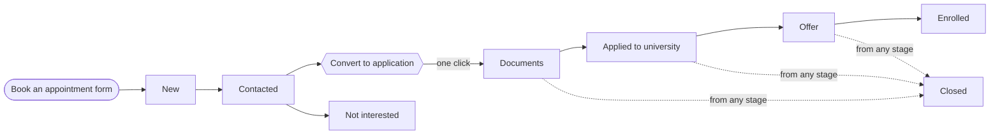

# GAP Student Pipeline: Step-by-Step Guide

For the admin and staff team. Also shared as a living document:
[GAP Student Pipeline guide](https://claude.ai/artifact/M6ueNJByhLneMTYAgi32ck).

## Overview

Every student moves through two records in the GAP workspace: a **Lead** while we are talking to
them, then an **Application** once they are ready to apply. One button, **Convert to application**,
moves a student from the first to the second.

- **Lead** = an enquiry. It has 4 stages: New, Contacted, Converted, Not interested.
- **Application** = the formal case. It has 5 stages: Documents, Applied to university, Offer,
  Enrolled, Closed.

Every student follows the top row, then the bottom row. Not interested and Closed are the two ways
out.

Changing a stage only records where the student is. The workspace never contacts a university for
you.

## Who does what

Admins hand out the work; staff work only on the students assigned to them.

| Task                                    | Admin                   | Staff                                |
| --------------------------------------- | ----------------------- | ------------------------------------ |
| See leads and applications              | All of them             | Only those assigned to them          |
| Assign a student to someone             | Yes                     | No                                   |
| Records they create themselves          | Assigned as they choose | Assigned to themselves automatically |
| Convert a lead to an application        | Any lead                | Their own leads                      |
| Delete leads, applications or documents | Yes                     | No                                   |
| Edit website content and settings       | Yes                     | Hidden                               |

If a student you need is missing from your list, ask an admin to assign them to you. Never create a
second record for the same student.

## Step 1: A new lead arrives

When a visitor clicks **Book an appointment** on the website, a lead appears in **Leads** with the
stage **New** and the team gets an email.

The lead holds what the student typed: name, email, phone, country of interest and a message. If the
same person sends the form twice within 10 minutes, it is saved only once.

**Admin:**

1. Open **Leads** and look for leads with an empty **Assigned to**.
2. Check the student isn't already in Leads or Applications (search by name or email).
3. Open the lead, choose the staff member in **Assigned to**, and save.

Website leads stay unassigned until an admin assigns them, so staff will not see them before then.

## Step 2: Talk to the student

Call or email the student, then record what happened on the lead so the next person can pick it up.

1. Open the lead (click its name in the list).
2. Change **Status** to **Contacted**.
3. Write what you discussed in **Staff notes**.
4. Set **Follow up on** to the date and time of your next contact. It will appear in **Reminders**
   when it is due.
5. Click **Save**.

Repeat this after every contact: update the notes and move the follow-up date. If the student
decides not to go ahead, set **Status** to **Not interested** and clear the follow-up date. When
they are ready to apply, go to Step 3.

## Step 3: Convert to an application

One click turns the lead into an application, links the two and marks the lead **Converted**.

1. Open the lead and make sure it is saved (the button is greyed out while you have unsaved
   changes).
2. In the right-hand sidebar, click **Convert to application**.
3. The new application opens. It already has a reference number such as GAP-20261029-9AEDC468.
4. Fill in what the enquiry didn't ask for: **Study level**, **University** and **Intake**.
5. Set **Next step** and **Follow up on**, then click **Save**.

| Copied from the lead                          | You add on the application          |
| --------------------------------------------- | ----------------------------------- |
| Name, email, phone                            | Study level                         |
| Message                                       | University                          |
| Country of interest (becomes the destination) | Intake                              |
| Assigned staff member                         | Priority, next step, follow-up date |

The application also starts with a 3-item document checklist: passport, academic transcripts and
English-language evidence. From now on, work on the application, not the lead. Clicking the button
again opens the same application; it never makes a duplicate.

## Step 4: Collect documents

Every new application starts at the **Documents** stage. It stays there until you have what the
university needs.

**Upload a file the student sends you:**

1. Go to **Documents** and click **Create new**.
2. Choose the student's **Application** and the **Document type** (passport/identity, academic,
   English language, financial or other).
3. Upload the file (PDF, JPEG, PNG or WebP; up to 4 MB on the live site) and save.
4. Check it, then set **Review status**: _received_, _approved_ or _needs update_. If it needs
   updating, say why in **Review note**.

**Then tick it off on the application:** in the application's **Documents** checklist, set that
item's status and attach the file.

Student documents are private. Only admins and the staff member assigned to that application can
open them. Never upload passports or certificates through **Media**, which is for public website
images.

## Step 5: Apply, offer, enrol

Move the application's **Status** forward each time something real happens, and save. Every change
is written to **Status history** automatically.

1. **Applied to university:** you have submitted the student's application to the university
   yourself.
2. **Offer:** the university has made an offer.
3. **Enrolled:** the student has accepted and enrolled. The case is finished.

At any stage, choose **Closed** if the student stops or the case ends without enrolment.

At every stage, keep **Next step** and **Follow up on** current, and use **Priority** (Low, Normal,
High, Urgent) for cases that need attention first. Enrolled and Closed applications no longer show
in Reminders.

## When a student already has an application

Every student starts as a lead: **Book an appointment** is the only student form on the website. If
a student already has an application (for example, a colleague created one), don't convert their
lead, which would create a second one. Instead:

1. Open their lead.
2. In the sidebar's **Application** field, select their existing application.
3. Save. The lead is marked **Converted** automatically.

If you can't find their application in that field, it isn't assigned to you. Ask an admin to assign
it.

## Reminders

The **Reminders** bell at the top of the workspace lists every lead and application whose **Follow
up on** date has arrived, including overdue ones.

- Staff see reminders for their own students; admins see the whole team's.
- It refreshes once a minute while the workspace is open, and immediately when you come back to the
  tab.
- Converted and Not interested leads, and Enrolled and Closed applications, are left out.

Opening a reminder does not clear it. After you follow up, set a new **Follow up on** date, clear
it, or move the student to a final stage, then save.

Reminders only appear inside the workspace. No email or phone notification is sent.

## Quick reference

**Lead stages**

| Stage          | Means                                    | Set by                                  |
| -------------- | ---------------------------------------- | --------------------------------------- |
| New            | Enquiry received, not contacted yet      | The website                             |
| Contacted      | You are in conversation with the student | You                                     |
| Converted      | The student has an application           | Automatic when an application is linked |
| Not interested | No further action                        | You                                     |

**Application stages**

| Stage                 | Means                                   | What you do here                                |
| --------------------- | --------------------------------------- | ----------------------------------------------- |
| Documents             | Collecting the student's documents      | Upload and review documents, tick the checklist |
| Applied to university | You have submitted it to the university | Follow up with the university                   |
| Offer                 | The university has made an offer        | Help the student accept and prepare             |
| Enrolled              | The student has enrolled                | Nothing; the case is finished                   |
| Closed                | Ended without enrolment                 | Nothing                                         |

**Every time you finish working on a student:** update the stage, write a note, set the next
**Follow up on** date, save.

## Common questions

| Problem                                            | What to do                                                                                                          |
| -------------------------------------------------- | ------------------------------------------------------------------------------------------------------------------- |
| **Convert to application** is greyed out           | You have unsaved changes. Click **Save**, then convert.                                                             |
| "…is not one of your destinations" when converting | The lead's **Country of interest** doesn't match a destination. Correct the spelling, save, and convert again.      |
| The button is missing on a new lead                | Save the lead first; only saved leads can be converted.                                                             |
| A student is missing from my list                  | They aren't assigned to you. Ask an admin.                                                                          |
| I ticked one row and clicked **Edit**              | That opens the student's full edit page. Ticking several rows opens bulk edit, which sets one value on all of them. |
| A reminder won't go away                           | Change or clear the **Follow up on** date, or move the student to a final stage, then save.                         |
| A student has two applications                     | Ask an admin to close or delete the duplicate application, and link the lead to the one you keep.                   |
